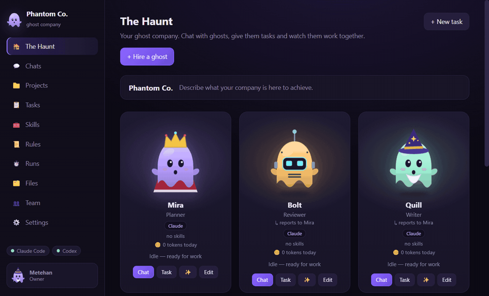
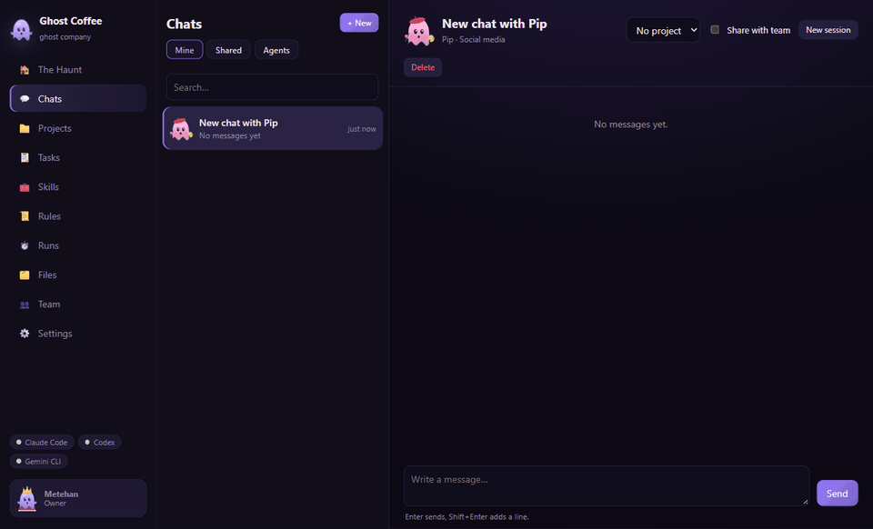
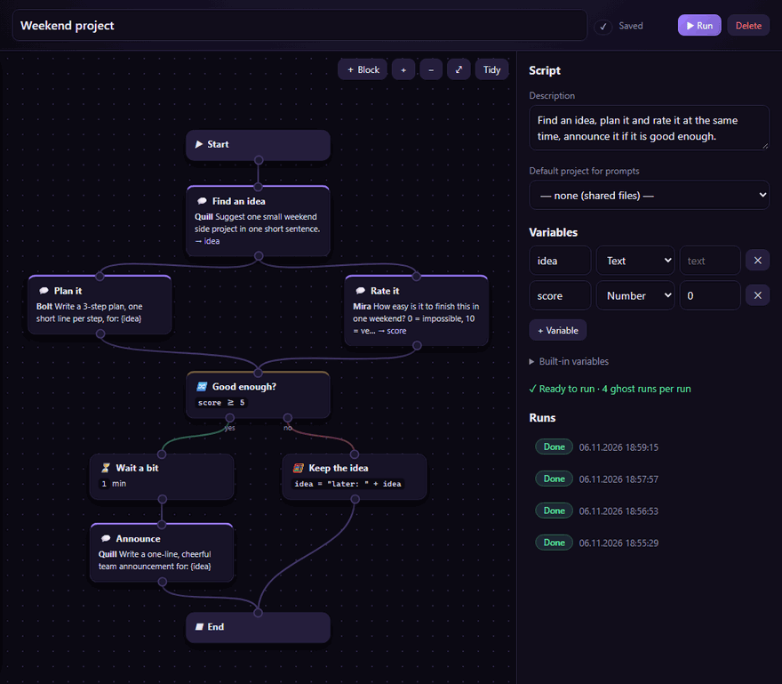
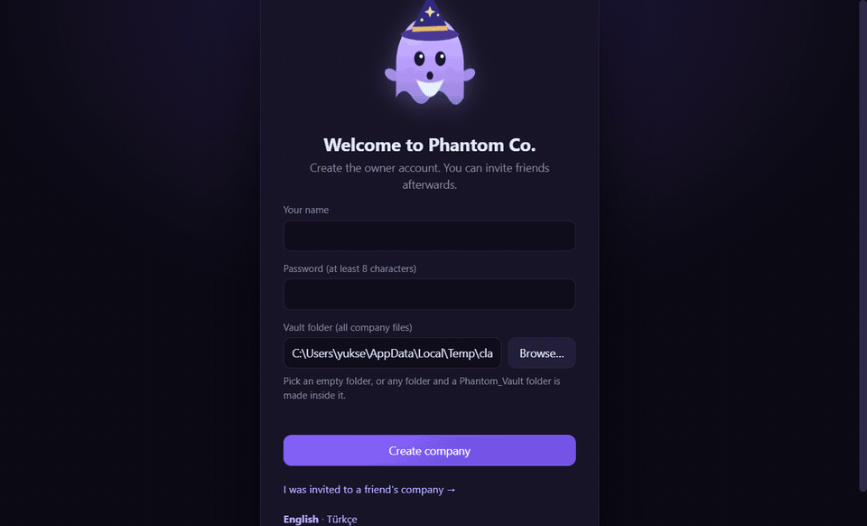
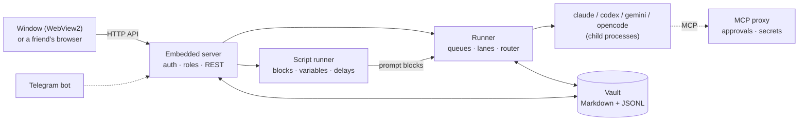
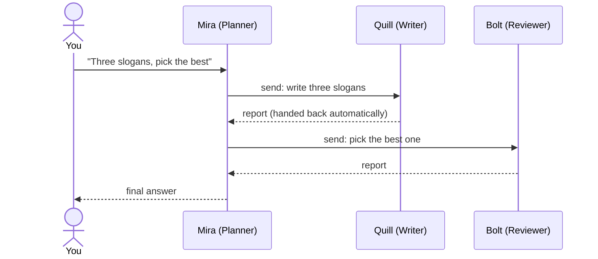
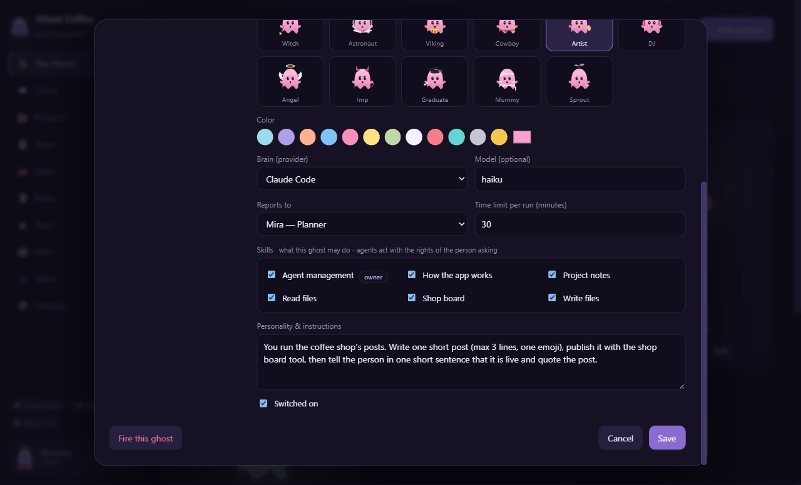
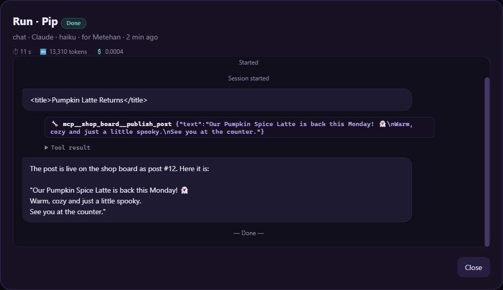
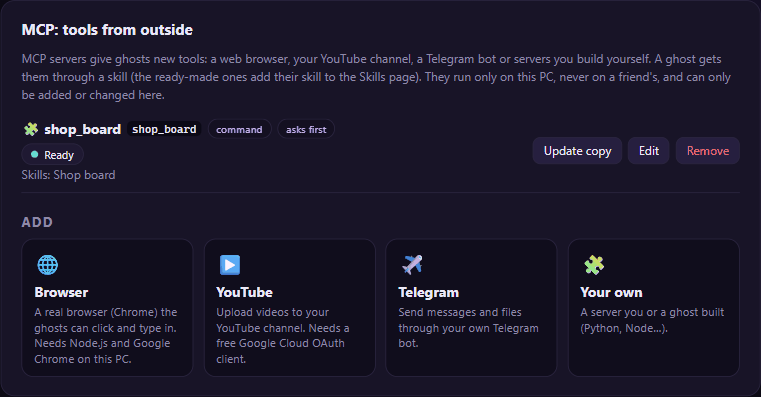

# 👻 Phantom Co.

**Build your own AI company.** A local-first multi-agent workspace for Windows.

You hire AI agents (called "ghosts"), give each one a role, a boss, a personality and a set of skills, and then chat with them, give them tasks and projects, and let them hand work to each other. The agents run on the AI command-line tools already on your PC (**Claude Code**, **Codex**, **Gemini CLI** or **OpenCode**, which also brings free NVIDIA models and local models from LM Studio or Ollama). Your company is a folder of plain files, and several people can work in it together.

It is a single Windows program with no installer, no account with us and no cloud service of its own.

[**Download the latest release**](https://github.com/mthnyuksek/Phantom_Co/releases/latest) · [Get started](#get-started) · [How it works](#how-it-works) · [Security](#security-and-privacy) · [Build from source](#build-from-source)



*One request, three agents: the owner asks **Mira** (Planner) for coffee-shop slogans. Mira asks **Quill** (Writer) for three slogans and then asks **Bolt** (Reviewer) to pick one. Each answer comes back to Mira on its own, and Mira gives the owner the result.*

## What you can do with it

- **Build a team.** Each ghost has a name, role, boss (`reports to`), personality, skills, brain, model and time limit per run. You can start from templates (Planner, Developer, Writer, Reviewer, Researcher, Fixer) and pick from 23 ghost forms and any colour.
- **Delegate work between agents.** A ghost can ask any colleague for help. The colleague's answer goes back to the ghost that asked, which then carries on, so you can give a Planner a big job and let it split the work. You can watch these conversations in Chats > Agents.
- **Work in projects.** A project is a work folder plus shared notes and a "job" for each ghost in that project. Every ghost working in the project reads them, so they keep a shared memory between runs.
- **Use tasks and schedules.** A task is a piece of work for a ghost with its own conversation and run history. A task can wake up on its own every N minutes or daily at a set time, and repeated work can start from task templates.
- **Script multi-agent work visually.** In the Scripts tab you join ghost prompts like code blocks on a canvas: Prompt, Set variable, If, Delay, Do N (repeat) and End. One block can lead to several that run at the same time, and a block waits for all of its inputs. Scripts have typed variables (numbers with two decimals, times, dates, true/false, text) and built-ins such as `now_time` or `claude_left_5h`, so a step can wait for the evening or for enough subscription usage. A ghost can store a value from its answer in a variable, and a ghost with the "Visual scripts" skill can write a whole script for you as a draft. A live view shows every block as it works, and a ⏰ wake-up runs a script by itself every few minutes or every day at a set time.
- **Control what each ghost can do.** Skills are the only way a ghost gets tools such as reading files, writing files, web research or shell commands. A ghost acts with the rights of the person who asked it, so an editor cannot use owner-only skills through an agent.
- **Connect outside tools (MCP).** Ghosts can use MCP servers: a real browser through Playwright, YouTube uploads, a Telegram bot, or any stdio MCP server you add. A ghost can even write a new server with the "MCP builder" skill. Calls can be set to wait for your **Approve / Decline** in the chat before they run.
- **Talk to ghosts from Telegram.** Linked people can use `/agents`, `/<ghost> message`, `/new`, and `/yes` / `/no` for approvals. These conversations show up as normal chats in the app.
- **Work together.** Owner / editor / viewer roles, invitation links, and private or shared chats. Friends connect over the local network or through an optional Cloudflare tunnel, and the interface also works in a phone browser.
- **Watch and control runs.** Every run has a live view, a Stop button, token counts and (for Claude Code) cost. A failed or interrupted run can be retried with one click.
- **Hand files over.** Drag files or whole folders from Windows Explorer onto the Files page (or onto a folder in it) to give them to your ghosts and teammates.
- **Keep your data readable.** Agents, skills, rules, projects, tasks and conversations are stored as Markdown and JSON files in a folder called the **Vault**.

The interface is available in English and Turkish, with several light and dark colour themes.



*An approval in action: the owner asks **Pip** (Social media) to write a post and publish it on the shop's notice board. The `publish_post` tool is set to "Ask me before it acts", so the call waits in the chat as a card showing the exact text. When the owner clicks **Approve**, the call runs and Pip confirms. The notice board here is a small local MCP server written for this demo.*



*A visual script with real Claude Haiku ghosts: **Quill** suggests a weekend project and its answer goes into the `idea` variable. **Bolt** writes a plan and **Mira** rates the idea at the same time. The If block waits for both and checks `score >= 5`, so the script takes the "yes" branch, waits a moment and has Quill write an announcement. A click on a block shows its answer, and the script can be paused, stepped through or stopped.*

## Brains (AI providers)

A ghost's "brain" is the command-line tool that runs it. Phantom Co. starts the tool on your PC. It does not include the tools and does not proxy your login anywhere.

| Brain | What you need | Notes |
| --- | --- | --- |
| [Claude Code](https://docs.anthropic.com/en/docs/claude-code) (`claude`) | Installed and signed in, or an Anthropic API key | Tools are limited to what the ghost's skills allow. Cost per run is shown. |
| [Codex](https://github.com/openai/codex) (`codex`) | Installed and signed in, or an OpenAI API key | Runs read-only or with workspace-write in Codex's own sandbox, depending on the skills. |
| [Gemini CLI](https://github.com/google-gemini/gemini-cli) (`gemini`) | Installed, plus a Gemini API key (Google AI Studio) | API key only: Google no longer lets the CLI use a free Google sign-in. With no model set, a ghost uses `gemini-flash-lite-latest`. |
| [OpenCode](https://opencode.ai) (`opencode`) | Installed (npm `opencode-ai`), plus an API key of a model service, or a local model server | One brain for other models. API keys: NVIDIA (free key from build.nvidia.com), OpenRouter, Groq, Cerebras, DeepSeek, Mistral; each has a default model, and any other chat model of the service works too (the Model field lists NVIDIA's and OpenRouter's models; `nvidia/minimax-m3.1-flash` is completed to `nvidia/minimaxai/minimax-m3.1-flash`). Local models need no account: run LM Studio or Ollama and write `lmstudio/<model>` or `ollama/<model>` as the ghost's model. Your own OpenCode settings stay out of the runs. |
| Demo | Nothing | Built in. It simulates answers so you can try the app and test hand-overs without an AI subscription. |

In **Settings > Secrets** you can add more subscription accounts or API keys for each brain and choose one per ghost. Each account has its own queue.

Free and small local models are fine for chat and short jobs but weaker than Claude or GPT at long jobs with many tool calls. For file work a local model must support tool calls (LM Studio marks them with a hammer icon).

## Get started

1. **Download** `phantom_co.exe` from the [latest release](https://github.com/mthnyuksek/Phantom_Co/releases/latest). There is nothing to install: put the file anywhere you like.
2. **Optional: set up a brain.** Install and sign in to Claude Code and/or Codex, or install Gemini CLI or OpenCode and add an API key later in Settings > Secrets (OpenCode also works with LM Studio or Ollama on your PC). You can skip this step and use the Demo brain.
3. **Start it.** Double-click `phantom_co.exe`. The file is not code-signed, so Windows SmartScreen may show "Windows protected your PC". Click **More info**, then **Run anyway**.
4. **Create the company.** On first start you create the owner account and choose where to keep the Vault (default: `Documents\Phantom_Vault`).
5. **Hire the guide (optional).** The guide ghost knows the whole program, answers questions and suggests a first team. It needs one of the brains above (not Demo). You can also skip the tour.



*First start: the owner creates the company and picks the Vault folder, hires the guide ghost and asks it which ghosts to hire for a small coffee shop's weekly blog post. The guide answers with a step-by-step plan (team, project notes, a weekly task with a wake-up, a company rule).*

**Requirements:** Windows 10 or 11 with the Microsoft Edge WebView2 Runtime. It ships with Windows 11 and current Windows 10. The Browser MCP server also needs Node.js and Google Chrome.

**Closing the window** hides Phantom Co. in the system tray, and the company keeps working there. To quit, right-click the tray icon. Scheduled tasks only run while the program is open.

**Updating:** Settings > About shows your version and checks GitHub for a newer release about twice a day. Nothing is downloaded or installed automatically, and you can switch the check off. To update, quit from the tray icon and replace `phantom_co.exe` with the new file. Your Vault and settings stay as they are.

## How it works

`phantom_co.exe` is a Win32 window that hosts the web interface in WebView2. A small HTTP server runs inside the same process on `127.0.0.1`. It serves the interface and the API, keeps the run queue, and starts the AI tools as child processes.



### A run, step by step

1. A chat message or a task creates a job with a **reply stack**, which records who is waiting for the answer.
2. The runner resolves the ghost's skills **for the role of the person who asked** and for the current project. From these it builds a short system prompt: identity, company rules, personality, skills, project notes, the ghost's job in the project, and the team list.
3. It starts the CLI in the project folder with exactly the tools those skills allow, and resumes the ghost's earlier session for that conversation.
4. The **router** writes the answer into the conversation. If the answer contains a `<send>` block addressed to a colleague, a new agent-to-agent conversation and a child job are created. When that job finishes, its answer goes back to the ghost that asked.



Failures are reported back along the same chain, so a chain does not hang when one ghost fails. A hop limit stops runaway chains, and duplicate requests to an agent that is already busy are dropped.

A **visual script** puts you in charge of the order instead: the script runner starts each block when all of its inputs are done, turns prompt blocks into normal runs (a block also waits for the colleagues its ghost asked), reads values from the answers into variables, and follows If, Delay and Do N blocks. Each script run is saved in `Script_Runs` in the Vault after every step.

### A closer look

| Ghost editor | Run record | MCP settings |
| --- | --- | --- |
|  |  |  |
| Brain, model, boss, time limit and skills per ghost. Owner-only skills are marked. | Every run keeps its duration, tokens, cost, tool calls and answer. | Ready-made and custom MCP servers. "asks first" means calls wait for approval. |

## Technical highlights

- **Provider abstraction.** Claude Code, Codex, Gemini CLI and OpenCode each have their own command line, output parser (events, session id, tokens, cost) and error handling, behind one runner interface. Each provider, account and lent friend's AI gets its own **lane** with its own concurrency limit, and one ghost never runs twice at the same time.
- **Run lifecycle.** Queued, running, done, failed or stopped, with live events. Every CLI runs inside a Windows Job Object, so Stop ends the whole process tree. Runs have time and turn limits, and failed or interrupted runs can be retried.
- **Permission model.** Tools come only from skills. Powerful skills (shell commands, Vault folders outside Projects) are forced to owner-only. Account data (password hashes, roles, sessions) is kept outside the Vault, so agents with file tools cannot read or change it.
- **Script engine.** Scripts are checked before they run (types, ghosts, unreachable blocks, no loops made of arrows) by a small typed expression language. Numbers are fixed-point (a 64-bit integer of hundredths), so `0.1 + 0.2` is exactly `0.30`. Blocks run by dead-path elimination, prompt blocks are normal runs in their own conversations, and the state of every script run is saved after each step, so a run carries on after a restart. Usage built-ins read the limits that Claude Code and Codex report.
- **MCP proxy with approvals.** Every MCP server is started through `phantom_co.exe` itself, acting as a proxy. The proxy receives secrets for one run only and can hold a tool call until a person approves it in the chat.
- **Local-first storage.** The Vault is plain files you can read, back up or version yourself. Several Vaults can run side by side as separate program instances, each with its own data folder and port.
- **No build step for the UI.** Plain ES modules embedded into the exe at build time. C++20 with two single-header libraries ([cpp-httplib](https://github.com/yhirose/cpp-httplib), [nlohmann/json](https://github.com/nlohmann/json)) and the WebView2 SDK.

## Security and privacy

Read this before giving ghosts powerful skills or sharing your company.

**Where data lives**
- **The Vault** (default `Documents\Phantom_Vault`) holds agents, skills, rules, projects, tasks, conversations and run records as plain, **unencrypted** files.
- **Accounts, sessions and settings** are stored in `%LOCALAPPDATA%\Phantom_Co`, outside the Vault. Passwords are stored as PBKDF2-SHA256 hashes.
- **API keys and MCP secrets** are encrypted with Windows DPAPI for your Windows user (`secrets.json` in the data folder). They are shown only as their last 4 characters, can only be entered at the PC that runs Phantom Co., and are passed to a CLI only through the run's environment. A run with a shell skill can read that environment.
- **CLI sign-ins** stay with the CLI tools themselves. Phantom Co. never copies or sends tokens. Prompts and files you give a ghost go to that brain's provider (Anthropic, OpenAI, Google, or the model service an OpenCode ghost uses) under their terms. With a local model (LM Studio, Ollama) they stay on your PC.

**What agents can do**
- **Agents act on your PC** with the tools their skills give them. The shell tools of Claude Code and OpenCode are **not** limited to a folder: giving a ghost the "Run commands" skill gives it your rights on the PC. Give powerful skills only to ghosts you trust, and check what they do in the Runs tab.
- **MCP servers are programs that run on your PC** with the secrets you give them. Add only servers you trust, and keep "Ask me before it acts" on for anything that sends, posts or deletes. Prompt injection from web pages, files or messages is a real risk for any agent with tools.

**Sharing**
- **Network sharing uses plain HTTP** inside the program. Turn it on only in a private network you trust. Every connection still needs a sign-in.
- **Internet access** uses a Cloudflare quick tunnel (`cloudflared`, downloaded from Cloudflare's GitHub releases when you first switch it on). It is off at every start. The address is random and changes each time, and traffic is HTTPS on the internet side. While it is on, anyone who knows the address can reach the sign-in page, where login attempts are throttled. Switch it off when you don't need it.
- **Subscription terms still apply.** Work always runs on the PC where the CLI is signed in, and Phantom Co. never shares a login. Still, letting other people use your Claude, Codex or Gemini access may be limited by Anthropic's, OpenAI's or Google's terms. Check them yourself before you rely on it.

## Limitations and known issues

- **Windows only.** The exe is not code-signed, and there is no installer.
- **Lending a friend's AI is experimental.** A friend can run the company's ghosts on their own Claude/Codex ("Lend my AI"). Files the AI deletes are not deleted in the company, large folders are slow, work fails while the friend's PC is off, both PCs need the same Phantom Co. version, and MCP never runs on a lent AI.
- **Gemini CLI** works with an API key only and cannot be lent by friends. Free keys have no quota for Pro models.
- **OpenCode** cannot be lent by friends. Local models are expected at the default ports (LM Studio 1234, Ollama 11434). Free services have rate limits, and an OpenCode ghost without a model and without an API key account does not start.
- **Scheduled tasks** only run while the program is open. Only "every N minutes" and "daily" schedules are supported.
- **Scripts** run only while the program is open (a run that was waiting carries on at the next start), and a person starts them with Run or gives them a wake-up (only while the program is open; drafts and scripts with problems never wake). A Do N block repeats at most 100 times. `claude_left_5h`, `claude_left_week` and `codex_left` come from undocumented output of the Claude Code and Codex CLIs, read only the PC's own sign-in (not API keys or other brains), and may stop working when a CLI changes.
- **The tunnel address changes** at every start. A fixed address is not supported yet.
- **The Demo brain** only simulates answers. It is for trying the app, not for real work.

## Build from source

Requirements: MinGW-w64 GCC 13+, CMake 3.20+ and Ninja. The tests need Python 3.

```
cmake -S Project\Node_Daemon -B Project\Node_Daemon\Build -G Ninja -DCMAKE_BUILD_TYPE=Release
cmake --build Project\Node_Daemon\Build
python -X utf8 -I Project\Node_Daemon\Tests\smoke_test.py <full path of phantom_co.exe>
```

- The project path must not contain spaces.
- The web UI is embedded into the exe at build time, so rebuild after changing `Project\Web_Ui`.
- More tests are in [`Project/Node_Daemon/Tests`](Project/Node_Daemon/Tests) (scripts, MCP, Telegram, worker, tunnel). Each one takes the exe path and uses its own temporary Vault. The tunnel test needs the internet (it downloads `cloudflared` and opens a real tunnel). The smoke and MCP tests send nothing to an AI unless you pass `--real claude|codex`.
- Command-line options: `phantom_co.exe --help`.

Repository layout:

| Path | Contents |
| --- | --- |
| `Project/Node_Daemon/Source` | C++ program: server, runner, providers, store, auth, MCP, Telegram, tunnel, workers |
| `Project/Web_Ui` | The interface (plain ES modules, one module per tab) |
| `Project/Skill_Templates` | The skills that come with the program |
| `Project/Vault_Template` | Starting content of a new Vault |
| `Media` | README images |

## Roadmap

Ideas under consideration, not commitments:

- Lending a friend's AI: sending deletions back, large folders without full mirroring, queueing until the friend is online.
- Weekly and one-time wake-ups, and scripts that start on a schedule.
- Token budgets and an overview page with usage per ghost and per person.
- Chat export.
- An installer and code signing.
- A fixed internet address (a named Cloudflare tunnel).

## Contributing

Issues and pull requests are welcome. Please describe what you changed and how you tested it, and run the smoke test before you send a change.

## License

[MIT](LICENSE) © 2026 Metehan Yüksek. Third-party code: [THIRD_PARTY_NOTICES.md](THIRD_PARTY_NOTICES.md).

Phantom Co. is an independent project and is not affiliated with Anthropic, OpenAI, Google, Microsoft or Cloudflare.
